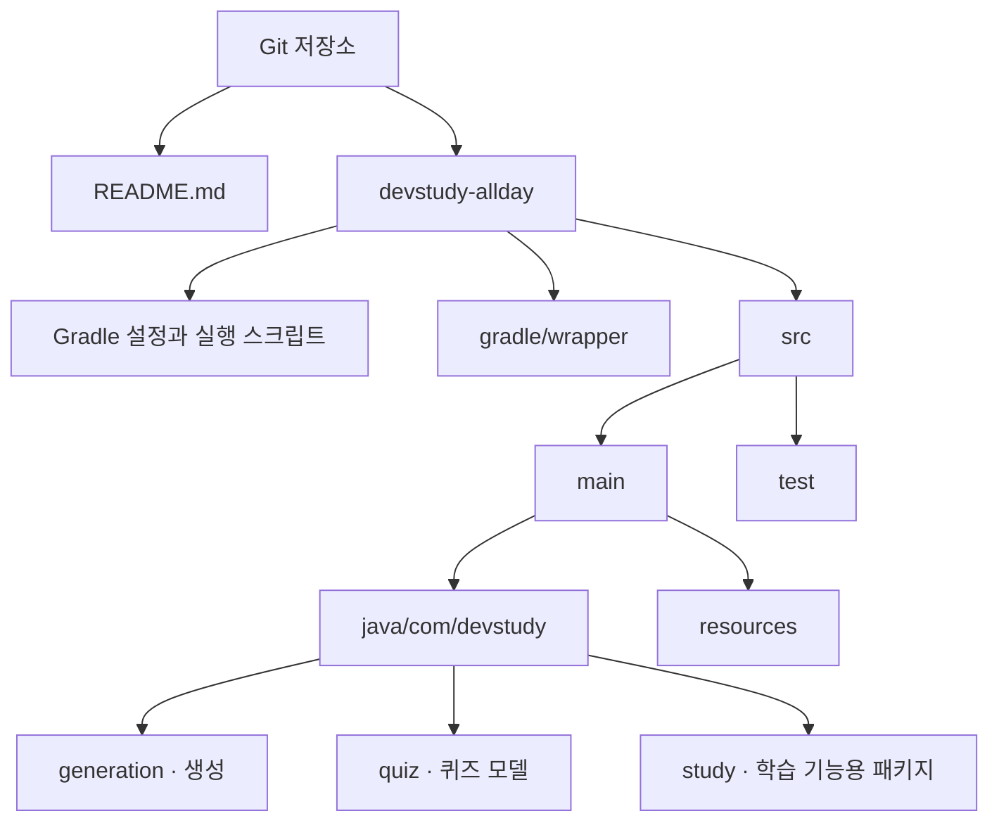

# 개발자 데일리 학습 프로그램

개발 기술과 개인 학습 주제를 매일 공부할 수 있도록 하루치 학습 자료를 만드는 Spring Boot 프로젝트입니다. 하루치 자료에는 **개발 주제와 퀴즈, 개인 학습 주제와 퀴즈, 개발 용어 설명**이 각각 하나씩 들어갑니다. 각 퀴즈에는 질문, 선지 4개, 정답 선지 ID, 선지별 해설을 담도록 설계했습니다.

## 개발 현황 · 2026-11-25

| 구분           | 오늘까지 작업한 내용                                                                                                                                |
| -------------- | --------------------------------------------------------------------------------------------------------------------------------------------------- |
| 프로젝트 설정  | Java 21, Spring Boot 4.2.0, Gradle Wrapper 9.9.2, Spring MVC 기반으로 초기화했습니다.                                                               |
| 생성 응답 모델 | `GenerationResult`에 하루치 결과를 담고, 두 학습 주제에는 `StudyContent`를 공통으로 사용합니다. `DevelopmentTerm`은 용어와 개념키, 설명을 담습니다. |
| 퀴즈 모델      | `Quiz`는 질문, 선지 목록, 정답 선지 ID를 담습니다. `QuizOption`은 선지 ID, 문구, 해설을 담습니다.                                                   |
| 생성 기능      | 생성 서비스, 주제 선정, 스케줄러의 클래스 뼈대를 만들었습니다. 검증기는 `validateQuiz(Quiz)` 시그니처와 검증 규칙, 샘플 JSON을 정리한 상태입니다.   |

다음 구현은 샘플 JSON을 `GenerationResult`로 변환하고, 두 퀴즈를 `validateQuiz()`에 전달하는 단계입니다. 필수값과 개념키는 학습 자료 단위에서, 선지 4개·ID `1~4`·정답 ID 일치 여부는 퀴즈 단위에서 검사할 예정입니다. 생성 API 연동, DB 게시 이력을 이용한 주제 선정, 예약 실행은 후속 단계입니다.

## 프로젝트 구조

아래 경로는 `devstudy-allday/` 기준입니다.

| 경로                                     | 파일 및 역할                                                                                                                                                                                                                                                                                    |
| ---------------------------------------- | ----------------------------------------------------------------------------------------------------------------------------------------------------------------------------------------------------------------------------------------------------------------------------------------------- |
| 프로젝트 루트                            | `build.gradle` · 플러그인, Java 버전, 의존성 및 테스트 설정 `settings.gradle` · Gradle 프로젝트 이름 `gradlew`, `gradlew.bat` · Gradle 실행 스크립트 `.gitattributes`, `.gitignore` · Git 설정                                                                                         |
| `gradle/wrapper/`                        | `gradle-wrapper.jar`, `gradle-wrapper.properties` · Wrapper 실행 및 Gradle 버전 설정                                                                                                                                                                                                            |
| `src/main/java/com/devstudy/`            | `DevstudyAlldayApplication.java` · Spring Boot 실행 클래스                                                                                                                                                                                                                                      |
| `src/main/java/com/devstudy/generation/` | `GenerationResult.java` · 하루치 생성 응답 모델 `generationService.java` · 생성 API 호출과 응답 처리 예정 `generationValidator.java` · 생성 응답 검증 예정 `topicSelector.java` · 개념키와 게시 이력을 기준으로 주제 선정 예정 `dailyScheduler.java` · 정해진 시각에 생성 실행 예정 |
| `src/main/java/com/devstudy/quiz/`       | `Quiz.java` · 퀴즈 모델 `QuizOption.java` · 선지 모델                                                                                                                                                                                                                                        |
| `src/main/java/com/devstudy/study/`      | 학습 기능용 패키지 폴더                                                                                                                                                                                                                                                                         |
| `src/main/resources/`                    | `application.yaml` · Spring Boot 설정 `static/`, `templates/` · 웹 리소스용 폴더                                                                                                                                                                                                             |
| `src/test/java/com/devstudy/allday/`     | `DevstudyAlldayApplicationTests.java` · Initializr가 생성한 Spring 컨텍스트 테스트                                                                                                                                                                                                              |
